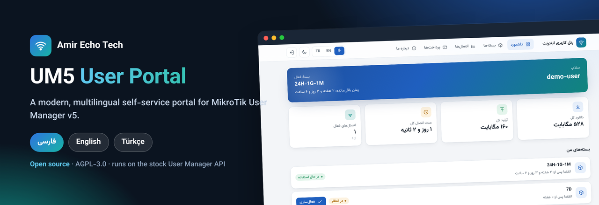
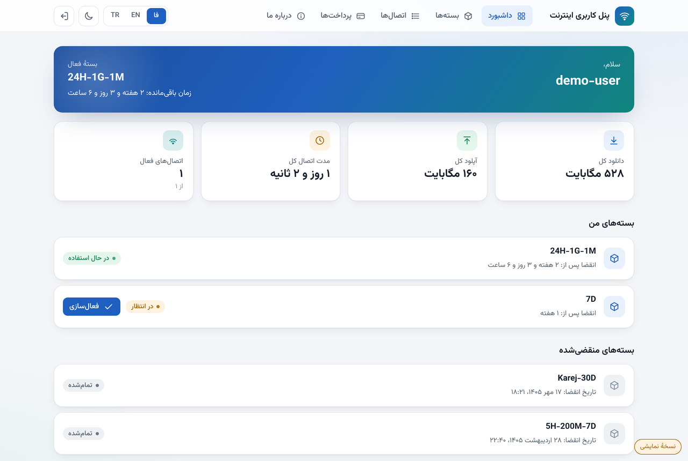
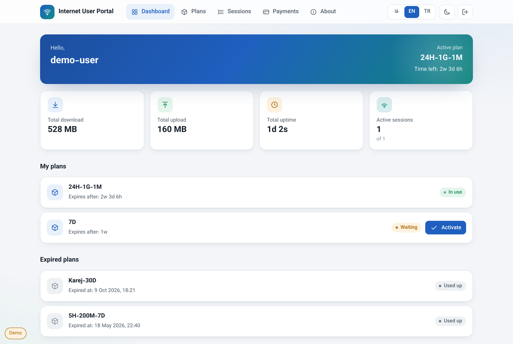
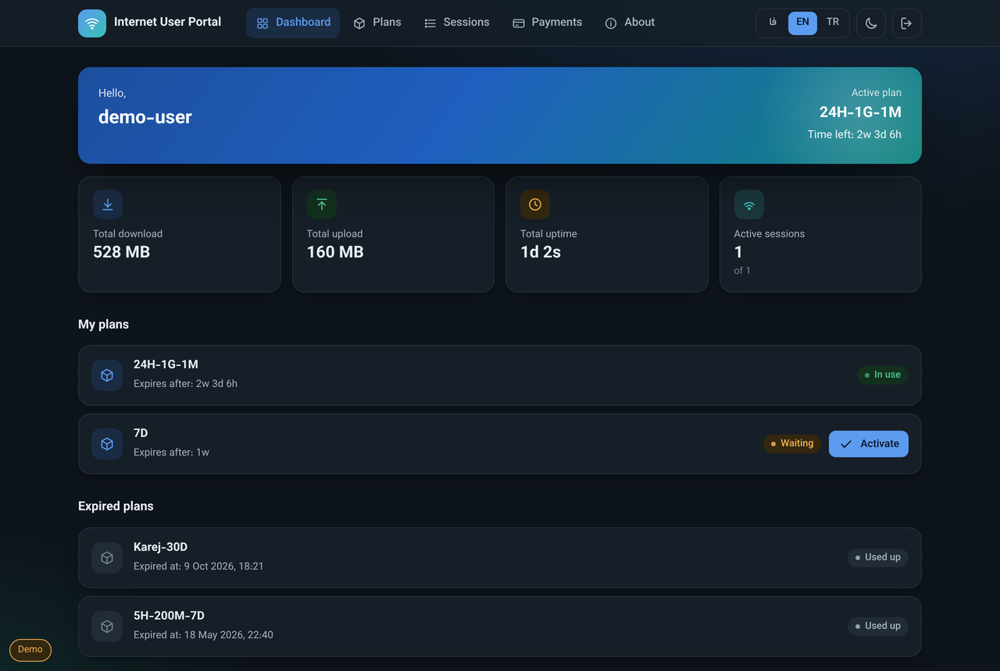
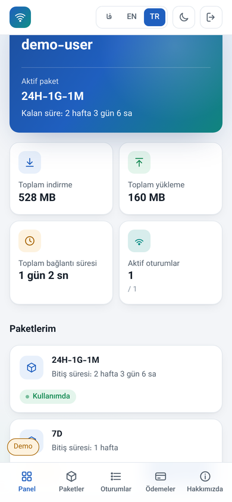

# پنل کاربری UM5

یک پنل کاربری تمیز، مدرن و **چندزبانه (فارسی / انگلیسی / ترکی)** برای
**MikroTik User Manager نسخهٔ ۵** — همان صفحه‌ای که مشتری‌های شما در
`http://<router>/um/` می‌بینند.

ساختهٔ [Amir Echo Tech](https://amirechotech.ca/). فقط ظاهر پنل را عوض می‌کند و
با **همان API یوزرمنیجر** کار می‌کند، پس هیچ سروری برای اجرا و نگهداری لازم نیست.

## تصاویر

| فارسی (راست‌چین) | انگلیسی |
|---|---|
|  |  |

| انگلیسی — حالت تیره | ترکی — موبایل |
|---|---|
|  |  |

## امکانات

- **سه زبان** با جابه‌جایی یک‌کلیکی و راست‌به‌چپ/چپ‌به‌راست خودکار.
- **تاریخ شمسی** و اعداد فارسی در زبان فارسی.
- حالت **روشن و تیره**؛ واکنش‌گرا تا عرض موبایل با نوار پایین صفحه.
- داشبورد (مصرف، بستهٔ فعال، زمان باقی‌مانده)، بسته‌های من با فعال‌سازی،
  تاریخچهٔ اتصال‌ها، پرداخت‌ها، و فروشگاه بسته با همان روند خرید اصلی.
- **مستقل**: فونت Vazirmatn همراهش است؛ بدون نیاز به CDN بیرونی.

## نصب روی روتر

> این فایل‌ها روی پوشهٔ `um5files` موجود **جایگزین** می‌شوند و فایل‌های خود
> میکروتیک (`PRIVATE/` و `img/`) را دست نمی‌زنند؛ آن‌ها باید سر جای‌شان بمانند.

۱. در WinBox بخش **Files** پوشهٔ وب یوزرمنیجر را پیدا کنید (مسیرش کنار `db-path`
   در `/user-manager/database/print` است). **اول یک بکاپ بگیرید.**
۲. پوشه‌های `user/`، `css/` و `js/` این مخزن را روی روتر کپی کنید و `fonts/` را
   اضافه کنید.
۳. آدرس `http://<router>/um/` را باز کنید و یک بار Ctrl+F5 بزنید.

برای بازگشت، بکاپ مرحلهٔ ۱ را برگردانید.

## تنظیمات

بالای فایل `um5files/js/generic.js`، بخش `UM_CONFIG`: نام برند (در سه زبان)،
زبان پیش‌فرض، تاریخ شمسی و اعداد فارسی. برای افزودن زبان جدید، یک بلوک در شیء
`I18N` کپی و کدش را به `UM_LANGS` اضافه کنید.

## لایسنس

**AGPL-3.0 به‌همراه یک بند اضافه**: استفاده، تغییر و انتشار آزاد است، ولی نام
سازنده (فوتر و صفحهٔ «درباره ما») باید حفظ شود. فایل‌های `LICENSE` و
`ADDITIONAL_TERMS.md` را ببینید. فونت Vazirmatn لایسنس جدا (SIL OFL) دارد.

ساختهٔ **[Amir Echo Tech](https://amirechotech.ca/)** ·
[لینکدین](https://www.linkedin.com/in/amir1360/) ·
[تلگرام](https://t.me/AmirEchoTech)

