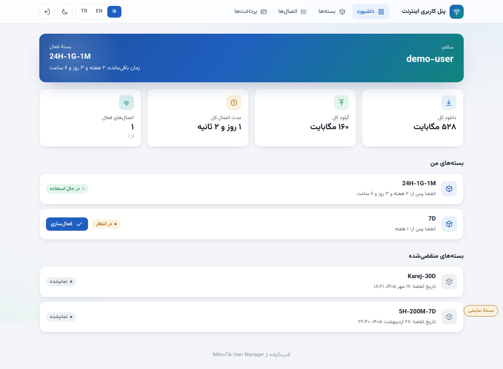

# UM5 User Portal

A clean, modern, **multilingual (Persian / English / Turkish)** self-service portal
for **MikroTik User Manager v5** — the page your customers see at `http://<router>/um/`.

Built by [Amir Echo Tech](https://amirechotech.ca/). It replaces only the look and
feel; it talks to the **same User Manager API** as the stock portal, so there is no
server to run and nothing new to maintain.

## Features

- **Three languages**, switchable in one click, with automatic RTL/LTR.
- **Persian calendar** (Jalali) dates and Persian digits when the language is Persian.
- **Light & dark** theme; responsive down to phone width with a bottom tab bar.
- Dashboard (usage, active plan, remaining time), my plans with activation,
  session history, payments, and the plan store with the stock buy flow.
- **Self-contained**: the Vazirmatn font ships with it; no external CDN.
- Same API endpoints as the original portal (`../api/login`, `getUser`, ...).

## Install on the router

> These files **overlay** the existing `um5files` directory on your router. They do
> not replace MikroTik's own files (`PRIVATE/`, `img/`), which must stay in place.

1. In WinBox/WebFig open **Files** and find the User Manager web directory
   (its path is the `db-path` shown by `/user-manager/database/print`, with a
   `um5files` folder next to it). **Back it up first.**
2. Copy the folders from this repo's `um5files/` over the ones on the router:
   `user/`, `css/`, `js/`, and add `fonts/`.
3. Open `http://<router>/um/` and hard-refresh once (Ctrl+F5).

To roll back, restore your backup from step 1.

## Configure

Open `um5files/js/generic.js` and edit the `UM_CONFIG` block at the top:

| Option | Meaning |
|---|---|
| `brand` | Portal name shown in the header, per language |
| `defaultLang` | `fa` \| `en` \| `tr` when the browser gives no hint |
| `jalaliDates` | Show Persian (Solar Hijri) dates in Persian |
| `persianDigits` | Show Persian digits in Persian |

Add a language by copying one block in the `I18N` object and adding its code to
`UM_LANGS`.

## License

**AGPL-3.0-or-later with an Additional Term**: you may use, change and share it
freely, but the author attribution (footer and About credit) must be preserved.
See [LICENSE](LICENSE) and [ADDITIONAL_TERMS.md](ADDITIONAL_TERMS.md).

The bundled **Vazirmatn** font is licensed separately under the SIL Open Font
License (`um5files/fonts/OFL.txt`).

---

Made by **[Amir Echo Tech](https://amirechotech.ca/)** ·
[LinkedIn](https://www.linkedin.com/in/amir1360/) ·
[Telegram](https://t.me/AmirEchoTech)
