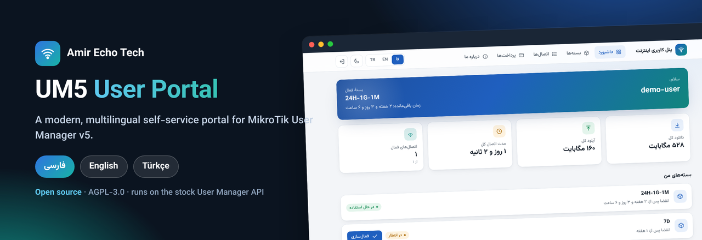
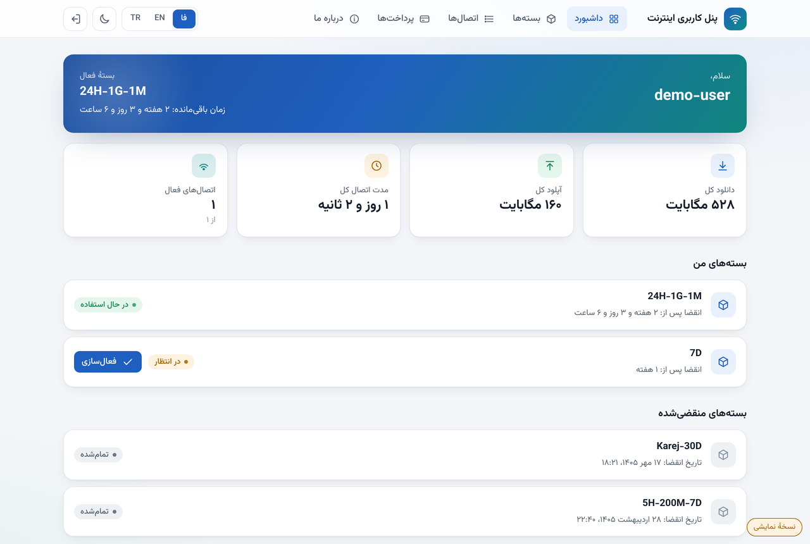
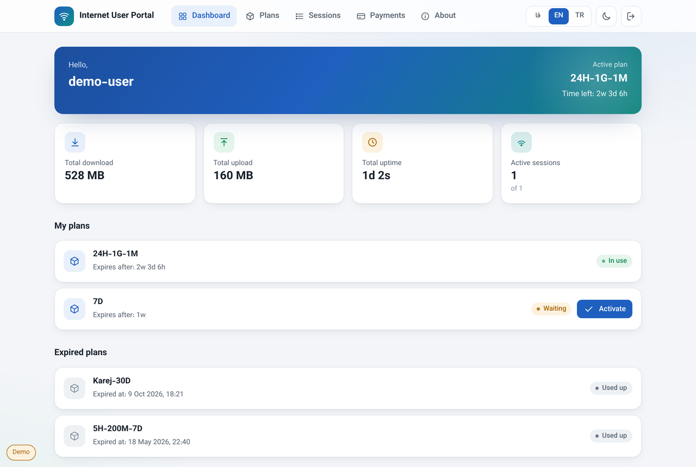
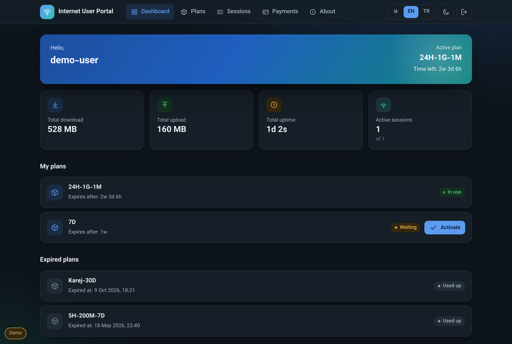
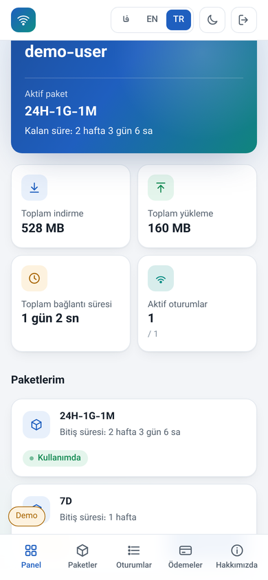

# UM5 Kullanıcı Paneli

**MikroTik User Manager v5** için temiz, modern ve **çok dilli (Farsça / İngilizce /
Türkçe)** self-servis paneli — müşterilerinizin `http://<router>/um/` adresinde
gördüğü sayfa.

[Amir Echo Tech](https://amirechotech.ca/) tarafından yapıldı. Yalnızca görünümü
değiştirir ve stok panelle **aynı User Manager API**'siyle çalışır; çalıştırılacak
bir sunucu yoktur.

## Özellikler

- Tek tıkla değişen **üç dil**, otomatik RTL/LTR.
- Farsça seçildiğinde **Celali (Şemsi) takvim** ve Farsça rakamlar.
- **Açık & koyu** tema; telefon genişliğine kadar duyarlı, alt sekme çubuğuyla.
- Panel (kullanım, aktif paket, kalan süre), paketlerim ve etkinleştirme, oturum
  geçmişi, ödemeler ve paket mağazası.
- **Bağımsız**: Vazirmatn yazı tipi gömülüdür; harici CDN yok.

## Ekran görüntüleri

| Farsça (RTL) | İngilizce |
|---|---|
|  |  |

| İngilizce — koyu | Türkçe — mobil |
|---|---|
|  |  |

## Router'a kurulum

> Bu dosyalar mevcut `um5files` klasörünün üzerine kopyalanır; MikroTik'in kendi
> dosyalarına (`PRIVATE/`, `img/`) dokunmaz, onlar yerinde kalmalıdır.

1. WinBox'ta **Files** bölümünde User Manager web dizinini bulun. **Önce yedek alın.**
2. Bu deponun `user/`, `css/`, `js/` klasörlerini router'a kopyalayın, `fonts/` ekleyin.
3. `http://<router>/um/` adresini açın ve bir kez Ctrl+F5 yapın.

## Lisans

**Ek Şartlı AGPL-3.0**: özgürce kullanab, değiştirip paylaşabilirsiniz, ancak yazar
atfı (alt bilgi ve Hakkımızda) korunmalıdır. `LICENSE` ve `ADDITIONAL_TERMS.md`
dosyalarına bakın. Vazirmatn yazı tipi ayrı lisanslıdır (SIL OFL).

**[Amir Echo Tech](https://amirechotech.ca/)** ·
[LinkedIn](https://www.linkedin.com/in/amir1360/) ·
[Telegram](https://t.me/AmirEchoTech)
